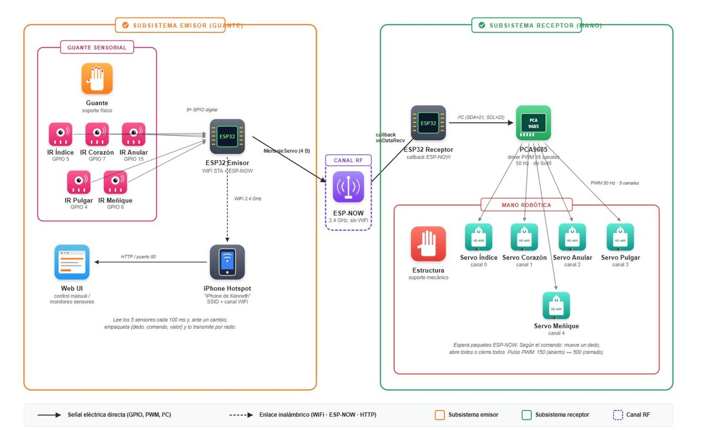
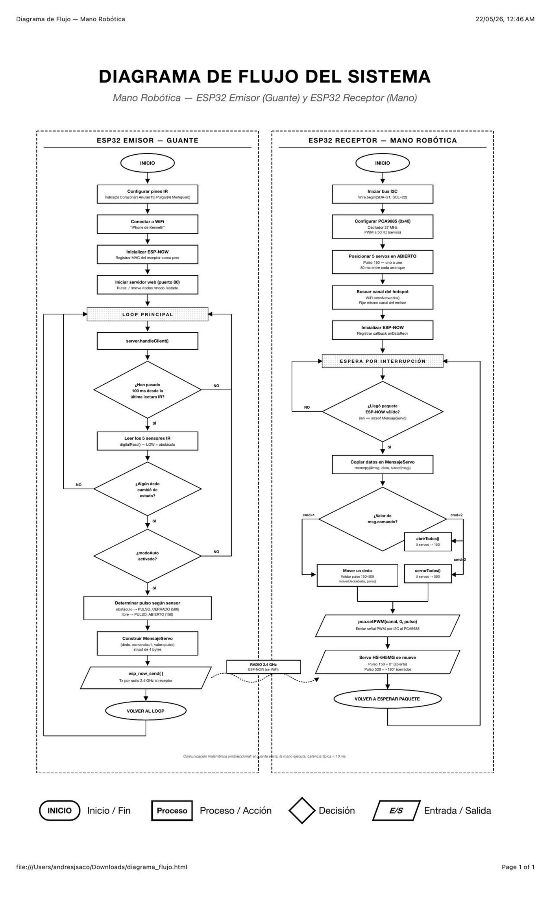
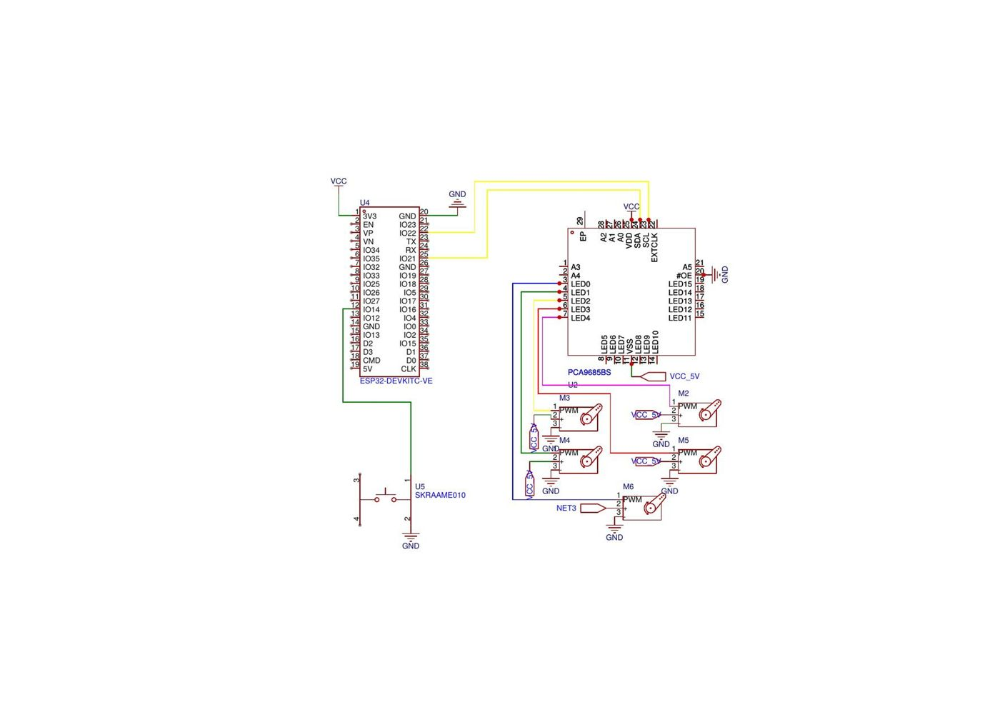
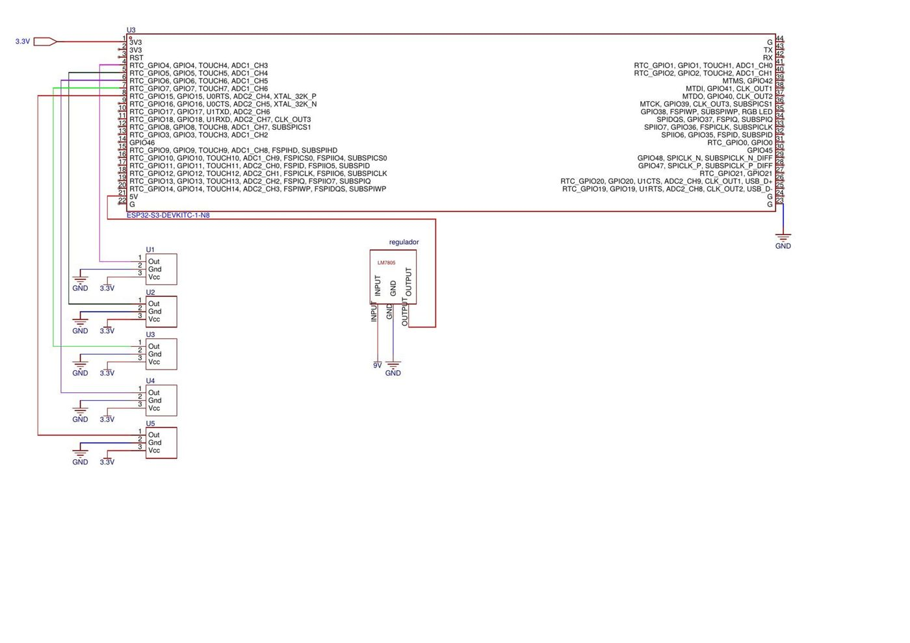
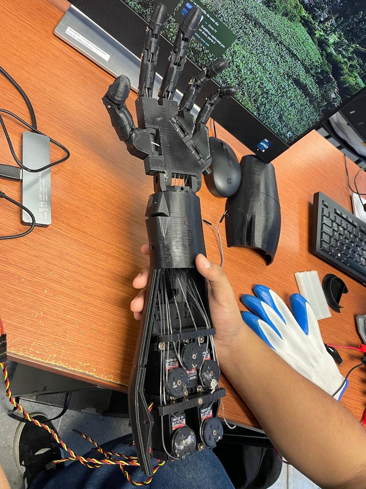

# Aria, a glove-teleoperated robotic hand

A five-finger robotic hand that copies the wearer's finger movements wirelessly. An instrumented glove reads the flexion of each finger and an ESP32 link replays the gesture on the hand in real time. Final project for the Microcontrollers course at Universidad del Norte, by Juan Andrés Betancourt and Kenneth Lascarro, presented under the product name Aria by Helix Robotics.

The 3D-printed hand, servos and nylon tendons are a mechanical prototype from a previous year's project; this project is the electronic control and teleoperation system that drives it.


## How it works

```
GLOVE (transmitter)                                    HAND (receiver)
ESP32-S3 N16R8                                         NodeMCU ESP32-S
5 IR reflective sensors, one per finger   ESP-NOW      PCA9685 16-ch PWM driver over I2C
Web server for manual control           ---------->    5 HS-645MG servos
9 V battery + LM7805                     2.4 GHz       Push button: rock-paper-scissors mode
```



- **Gesture mode.** The glove reads its five IR sensors every ~100 ms and, whenever a finger changes state, sends a 4-byte command over ESP-NOW. The hand moves that finger.
- **Web mode.** The glove also serves a control page on port 80 with a slider per servo, sweep buttons, open and close poses, live sensor state, and an AUTO / MANUAL switch. Web commands travel over the same ESP-NOW channel as gestures.
- **Game mode.** A push button on the hand plays a random rock-paper-scissors move.

End-to-end latency is a few milliseconds, dominated by ESP-NOW transmission (typically 1 to 10 ms) and servo travel.

<details>
<summary>Firmware flow for both boards</summary>



</details>

## Why ESP-NOW

ESP-NOW sends vendor-specific 802.11 action frames directly from MAC to MAC: no router, no DHCP, no TCP/IP stack. Latency is 1 to 10 ms versus tens or hundreds of ms for HTTP or MQTT over Wi-Fi, which is what makes the hand feel immediate.

**The channel problem.** ESP-NOW only works when both radios are on the same Wi-Fi channel. The glove joins a phone hotspot to serve the web page, so its channel is whatever the hotspot assigns. The receiver therefore runs `WiFi.scanNetworks()` at boot, finds the hotspot and locks its radio to the same channel before starting ESP-NOW. This was the hardest integration issue in the project.

### Command format

```cpp
struct MensajeServo {   // 4 bytes
  uint8_t  dedo;        // finger index 0..4
  uint8_t  comando;     // 1 = move one finger, 2 = open all, 3 = close all
  uint16_t valor;       // target pulse width (150..500)
};
```

## Hardware

### Hand: NodeMCU ESP32-S

| Component | Connection | Notes |
|---|---|---|
| PCA9685 SDA / SCL | GPIO 21 / GPIO 22 | Default hardware I2C pins, address 0x40 |
| PCA9685 VCC | 3.3 V | Logic only |
| PCA9685 V+ | External 5 to 6 V supply | Servo power, 1000 µF reservoir capacitor |
| PCA9685 OE | GND | Outputs always enabled |
| Servos | CH0 index, CH1 middle, CH2 ring, CH3 thumb, CH4 pinky | Pulse 150 open, 500 closed; thumb inverted in software |
| Push button | GPIO 14 | `INPUT_PULLUP` |



### Glove: ESP32-S3 N16R8

| IR module | GPIO | Finger |
|---|---|---|
| 1 | 5 | Index |
| 2 | 7 | Middle |
| 3 | 15 | Ring |
| 4 | 4 | Thumb |
| 5 | 6 | Pinky |

The glove runs on a 9 V battery through an LM7805 into VIN, so it works without a USB cable. GPIOs were chosen to avoid USB, flash/PSRAM and strapping pins on the S3.



### Why these parts

- **ESP32-S3 on the glove** for GPIO headroom, 16 MB flash and 8 MB PSRAM for the web server, and native USB for debugging while wearing it.
- **Classic ESP32 on the hand**, since the PCA9685 does the PWM work and only I2C plus one button are needed.
- **PCA9685** to generate five jitter-free 50 Hz servo signals in hardware. Its internal oscillator is calibrated to about 27 MHz in firmware so the output is exactly 50 Hz.
- **HS-645MG servos** (7.7 to 9.6 kg·cm) for the torque needed to pull the tendons against friction in the printed joints.

## Control details

- **Staggered motion.** Opening or closing the whole hand starts each finger about 250 ms apart. This keeps the five servos from drawing their peak current at the same time and makes the gesture look natural.
- **Per-finger calibration.** Each finger has its own open and closed pulse limits so no servo hits its mechanical stop or leaves a finger half closed.
- **Thumb inversion.** The thumb servo is mounted opposite to the others; an `invertido[]` flag array corrects it in software instead of remounting it.



## Power budget

| Side | Typical | Peak |
|---|---|---|
| Glove (ESP32-S3 with Wi-Fi, 5 IR modules, LM7805 losses) | ~400 mA | Wi-Fi connect |
| Hand (ESP32, PCA9685, 5 servos) | ~860 mA | ~4.5 A with all servos under load |

A 5 V / 5 A external supply is recommended for the hand.

## Problems and fixes

| Problem | Cause | Fix |
|---|---|---|
| Three CNY70 sensors burned | Potentiometer in series with the LED anode removed its current limit | Adjust sensitivity at the phototransistor collector instead; switched to integrated IR modules |
| Velostat flex sensors unavailable | Not obtainable in Barranquilla in time | Moved to reflective IR sensing |
| PCA9685 not responding | Faulty unit, confirmed with an I2C scanner | Replaced |
| ESP32 brownout on Wi-Fi connect | Voltage drop from 9 V battery and LM7805 | 470 to 1000 µF capacitor on VIN |
| ESP-NOW link not working | Transmitter and receiver on different Wi-Fi channels | Receiver scans for the hotspot and matches its channel |
| Thumb moving backwards | Servo mounted in the opposite direction | Software inversion flag |
| Fingers drifting out of calibration | Nylon tendons stretch with use | Re-tension and recalibrate per-finger limits |

## Limitations and next steps

- The IR modules are read through their on-board comparator, so each finger is either open or closed. Reading the phototransistor with the S3's ADC would give proportional, continuous finger tracking.
- Each finger has one degree of freedom; there is no independent phalanx or side-to-side motion.
- Nylon tendons creep over time; a low-stretch braided line would hold calibration longer.

## Full report

The complete project report (in Spanish) is in [`docs/Informe_Final_Aria.docx`](docs/Informe_Final_Aria.docx).

## Stack

ESP32-S3, ESP32, ESP-NOW, PCA9685, I2C, HS-645MG servos, Arduino Core 3.x, C++, embedded web server.
